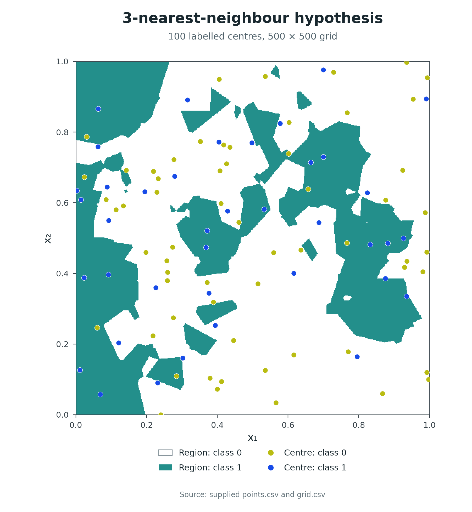
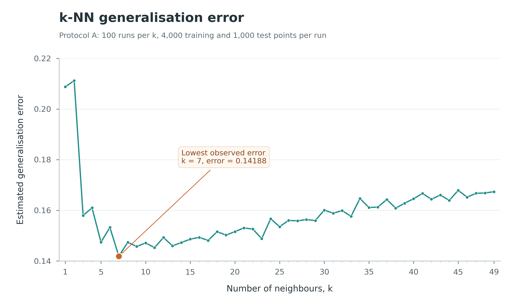
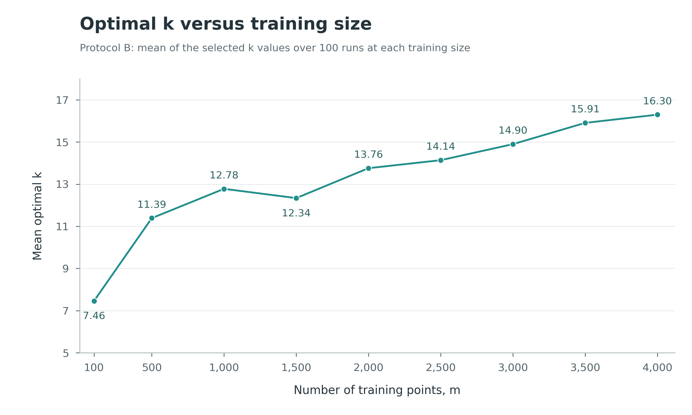

# k-Nearest Neighbours in Rust

An implementation and analysis of the **k-Nearest Neighbours (k-NN)** classification algorithm written in Rust.
The project explores how the number of neighbours \(k\) affects classification performance and how the optimal choice of \(k\) changes with the size of the training dataset.

## 1. Overview

k-Nearest Neighbours is a supervised learning algorithm that classifies observations based on the labels of their \(k\) closest training points.

For each query point, the implementation:

1. Calculates the squared Euclidean distance to every training observation.
2. Sorts the observations by distance.
3. Selects the \(k\) nearest neighbours.
4. Assigns the majority class among those neighbours.

For binary classification, ties are resolved by randomly selecting either class with equal probability.
The algorithm is implemented from scratch in **Rust**, without relying on an existing machine learning library.

## 2. Generating the underlying classification problem

Each experiment begins by constructing a randomly generated *voted-centre hypothesis*, denoted \(h_{S,3}\).

The hypothesis is defined by 100 labelled centres, with:

- Coordinates sampled independently and uniformly from the two-dimensional domain \([0,1]^2\).
- Binary labels sampled independently and uniformly from \(\{0,1\}\).

The hypothesis assigns any point \(x\) the majority label of its three nearest centres.

### Visualising the hypothesis

The hypothesis is evaluated over a regular 500 × 500 grid covering the unit square. Each grid point is classified using the three nearest labelled centres.

*Figure 1: Decision regions generated by a randomly sampled 3-NN hypothesis. White and turquoise regions represent classes 0 and 1, respectively. Yellow and blue markers indicate the original labelled centres.*

The resulting decision regions have irregular boundaries determined by the spatial distribution and labels of the centres.

## 3. Generating noisy observations

To investigate generalisation performance, training and test observations are generated from a noisy distribution defined by the underlying hypothesis.

Each observation has coordinates sampled uniformly from \([0,1]^2\).

Its label is generated according to the following procedure:

- With probability **0.8**, assign the label predicted by the underlying 3-NN hypothesis.
- With probability **0.2**, assign a uniformly random binary label.

Because a randomly assigned label agrees with the underlying hypothesis half the time, the resulting label agrees with the hypothesis with probability 0.9.

This introduces an irreducible classification error of 0.1.

The original 100 centres are used only to define the data-generating hypothesis. The classifiers evaluated in the experiments use newly generated training observations.

## 4. Experiment A: Generalisation error as a function of k

**Objective:** Investigate how the number of nearest neighbours affects classification performance.

### Experimental protocol

For each \(k\) from 1 to 49:

1. Generate a new random hypothesis from 100 labelled centres.
2. Generate 4,000 noisy training observations.
3. Generate 1,000 independently sampled noisy test observations.
4. Classify the test observations using k-NN with the generated training dataset.
5. Calculate the proportion of incorrectly classified test observations.
6. Repeat the experiment 100 times and calculate the mean classification error.

### Results

*Figure 2: Mean estimated generalisation error as a function of k, calculated over 100 independent experiments for each value.*

The generalisation error initially decreases as \(k\) increases, reaching a minimum of approximately **0.142 at k = 7**.

This illustrates the bias–variance trade-off:

- **Small k:** Predictions are sensitive to individual noisy training observations, resulting in high variance.
- **Intermediate k:** Majority voting reduces the influence of noisy observations while preserving local structure.
- **Large k:** Increasingly distant and potentially less relevant observations influence the predictions, introducing greater bias.

For smaller values of \(k\), even values frequently exhibit slightly higher error than neighbouring odd values because tied majority votes require random predictions.

The observed minimum is above the theoretical noise floor of 0.1 because the learned classifier cannot perfectly reconstruct the underlying hypothesis from finite, noisy training data.

## 5. Experiment B: Optimal k as a function of training set size

**Objective:** Investigate how the optimal number of neighbours changes as the training dataset grows.

### Experimental protocol

The experiment considers nine training set sizes:

100, 500, 1,000, 1,500, 2,000, 2,500, 3,000, 3,500 and 4,000 observations.

For each training set size:

1. Perform 100 independent experimental runs.
2. Within each run, evaluate all values of \(k\) from 1 to 49.
3. For each \(k\), independently generate a new underlying hypothesis, training dataset and test dataset.
4. Calculate the estimated generalisation error for that \(k\).
5. Select the value of \(k\) achieving the lowest error within the run.
6. Average the 100 selected optimal values of \(k\).

When multiple values of \(k\) achieve the same minimum error, the smallest is selected.

### Results

*Figure 3: Mean estimated optimal k against the number of training observations, averaged over 100 experimental runs.*

The mean optimal value of \(k\) generally increases with training set size.

| Training observations | Mean optimal k |
|---:|---:|
| 100 | 7.46 |
| 500 | 11.39 |
| 1,000 | 12.78 |
| 1,500 | 12.34 |
| 2,000 | 13.76 |
| 2,500 | 14.14 |
| 3,000 | 14.90 |
| 3,500 | 15.91 |
| 4,000 | 16.30 |

As the training dataset grows, the observations become more densely distributed throughout the input space.

Consequently, a classifier can consider more neighbours without extending as far from the query point. This allows larger values of \(k\) to reduce prediction variance while limiting the additional bias introduced by including more observations.

The small non-monotonic fluctuations are consistent with sampling variability across independently generated classification problems.

### Comparing Experiments A and B

At 4,000 training observations, Experiment A identifies \(k=7\) as having the lowest mean generalisation error, whereas Experiment B produces a mean selected optimal \(k\) of 16.30.

These results are not directly equivalent:

- **Experiment A** identifies the value of \(k\) minimising the average error across experiments.
- **Experiment B** identifies the optimal \(k\) within each experimental run and then averages those selected values.

The distinction, combined with the independently sampled datasets used in Experiment B, explains why the two estimates can differ.

## 8. Conclusions

These experiments demonstrate two important properties of k-NN classification.

First, neither very small nor very large values of \(k\) necessarily provide the best generalisation performance. Intermediate values balance sensitivity to noise against the bias introduced by including more distant neighbours.

Second, the optimal value of \(k\) tends to increase with training set size. Larger datasets allow classifiers to aggregate information from more observations while remaining sufficiently local to preserve the underlying classification structure.

Together, these results illustrate the relationship between neighbourhood size, dataset size, and the bias–variance trade-off in non-parametric classification.